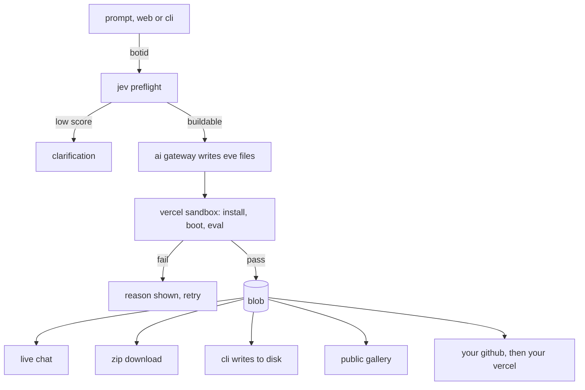

# ▲ tryeve

**agent builder for eve.**

[live demo](https://tryeve.abhivarde.in) · [cli](https://www.npmjs.com/package/@abhivarde/tryeve) · built with ▲ [vercel](https://vercel.com)

describe an agent in one sentence. tryeve writes real eve files, boots them in an isolated sandbox on the actual eve runtime, and shows you the result only after the agent has answered a live test.

use it in the browser or from your terminal. same live test either way.

## use it from the web

1. describe an agent
2. watch the build steps run live
3. chat with it, download it as a zip, share a link, publish it to the gallery, or deploy it to your own github and vercel

your agent, chat and files survive a page reload.

## use it from the cli

```bash
npx @abhivarde/tryeve "agent that rewrites any sentence clearer and shorter"
```

the first run asks you to sign in with github once: a short code, one click in the browser, and a key is saved to `~/.config/tryeve/config.json`. tryeve reads only your public profile and never stores your github token.

```
  tryeve 0.5.0

  ✓ prompt looks buildable             5s
  ✓ agent written                      4s
  ✓ live eve test finished             57s

  ✓ passed a live eve test · 2m 06s
```

the agent is written to a folder with its tools, an eval, `.env.example`, `.gitignore` and a short readme. run it:

```bash
cd <folder>
cp .env.example .env    # use copy on windows, then add AI_GATEWAY_API_KEY
npm install
npm run dev
```

ship it from inside the agent folder:

```bash
npx @abhivarde/tryeve deploy github    # new private repo, add --public for public
npx @abhivarde/tryeve deploy vercel    # deploys with your vercel account
```

`deploy github` needs [git](https://git-scm.com) and the [github cli](https://cli.github.com) signed in with `gh auth login`. after `deploy vercel`, add `AI_GATEWAY_API_KEY` in your vercel project so the agent can answer.

agents that connect to a real service are written untested, since tryeve never holds your credentials. the variables they need are listed in the output and in `.env.example`.

### use it from a coding agent

```bash
echo "agent that triages support emails" | npx @abhivarde/tryeve - --json
```

`--json` prints one object on stdout: `ok`, `id`, `share`, `tested`, `env`, `dir`, `files`. progress and errors go to stderr.

to teach a coding agent the workflow, copy [`skills/tryeve`](skills/tryeve/SKILL.md) into its skills folder, for claude code that is `.claude/skills/tryeve/`.

### options

| flag                           | what it does                                            |
| ------------------------------ | ------------------------------------------------------- |
| `-o, --out <dir>`              | output folder, defaults to a name from the prompt       |
| `--force`                      | write into a folder that isn't empty                    |
| `--open`                       | open the web page for the agent when the build finishes |
| `--public`                     | make the github repo public, default is private         |
| `--json`                       | machine-readable output, nothing else on stdout         |
| `--url <base>`                 | api base, or set `TRYEVE_URL`                           |
| `-h, --help` / `-v, --version` | help and version                                        |

### commands

| command         | what it does                                              |
| --------------- | --------------------------------------------------------- |
| `deploy github` | push the agent in the current folder to a new github repo |
| `deploy vercel` | deploy the agent in the current folder to vercel          |
| `login`         | sign in with github, or `login --key` to paste a key      |
| `logout`        | remove the saved key                                      |

### exit codes

| code | meaning                               |
| ---- | ------------------------------------- |
| `0`  | built and written to disk             |
| `1`  | error or failed build                 |
| `2`  | prompt too vague, needs clarification |

the cli writes only under `agent/` and `evals/`, plus the project files it creates itself. anything else in a response is skipped.

## how it works

1. a botid check rejects bot traffic before it costs anything
2. a jev preflight checks the prompt is buildable, a low score returns a clarification instead of spending a sandbox
3. the ai gateway routes the request to a model, switchable live with flags sdk, which writes the eve files
4. a vercel sandbox installs eve and boots it, no stubs
5. tryeve runs the agent's eval against the live runtime and streams real progress to the page or terminal
6. on a pass, the sandbox stays alive so chatting is instant, and the agent, session and transcript are stored in blob
7. optionally deploy to your own github through vercel connect, then to your own vercel account

steps 3 to 5 run as one durable workflow step, so a crash mid build doesn't lose the request. a cron job sweeps sandboxes left behind by closed tabs.

full breakdown, including real bugs hit along the way: [HOW_IT_WORKS.md](https://github.com/AbhiVarde/tryeve/blob/main/HOW_IT_WORKS.md) and [ARCHITECTURE.md](https://github.com/AbhiVarde/tryeve/blob/main/ARCHITECTURE.md).



## built with ▲

| product                                                                       | role                                                     |
| ----------------------------------------------------------------------------- | -------------------------------------------------------- |
| [next.js](https://nextjs.org)                                                 | the app                                                  |
| [ai gateway](https://vercel.com/docs/ai-gateway)                              | routes generation to a model                             |
| [ai sdk](https://sdk.vercel.ai)                                               | streams model output                                     |
| [sandbox](https://vercel.com/docs/sandbox)                                    | tests and runs every agent on a real eve runtime         |
| [workflow sdk](https://vercel.com/docs/workflow)                              | runs generate and test as one durable step               |
| [blob](https://vercel.com/docs/storage/vercel-blob)                           | stores agents, sessions, transcripts and history         |
| [cron](https://vercel.com/docs/cron-jobs)                                     | sweeps stale sandbox sessions                            |
| [firewall](https://vercel.com/docs/vercel-firewall)                           | rate limits generation, connect and chat                 |
| [connect](https://vercel.com/docs/connect)                                    | short-lived github tokens for deploys, no stored secrets |
| [botid](https://vercel.com/docs/botid)                                        | blocks bot traffic on generation                         |
| [flags sdk](https://vercel.com/docs/feature-flags)                            | switches the model or pauses generation, no redeploy     |
| [vercel marketplace integration](https://vercel.com/docs/integrations)        | oauth for deploying to your own vercel account           |
| [next/og](https://nextjs.org/docs/app/api-reference/functions/image-response) | gallery preview images                                   |
| [ai elements](https://ai-sdk.dev/elements)                                    | chat ui, progress and loading states                     |
| [streamdown](https://streamdown.ai)                                           | renders code and markdown                                |
| [shadcn/ui](https://ui.shadcn.com)                                            | ui components                                            |
| [analytics](https://vercel.com/docs/analytics)                                | usage tracking                                           |
| [vercel](https://vercel.com)                                                  | hosting                                                  |
| [jev](https://www.typesafe.ai)                                                | scores whether a prompt is buildable                     |

icons animated by [lucide-animated](https://lucide-animated.com).

## run it locally

```bash
git clone https://github.com/AbhiVarde/tryeve.git
cd tryeve
npm install
vercel link
vercel env pull
npm run dev
```

open [localhost:3000](http://localhost:3000).

### environment variables

tryeve needs a blob token and at least one model credential:

```bash
BLOB_READ_WRITE_TOKEN=

# at least one
AI_GATEWAY_API_KEY=
VERCEL_OIDC_TOKEN=
ANTHROPIC_API_KEY=
OPENAI_API_KEY=

# only for github and vercel deploy
GITHUB_CONNECTOR_UID=github/tryeve
GITHUB_OAUTH_CLIENT_ID=
GITHUB_OAUTH_CLIENT_SECRET=
```

→ `VERCEL_OIDC_TOKEN` is created when the project is linked, `vercel env pull` handles it locally
→ `GITHUB_CONNECTOR_UID` is the vercel connect github app connector used to push files, see the [connect docs](https://vercel.com/docs/connect)
→ the oauth client id and secret come from a separate classic github oauth app, used only to create the repo, because github apps can't create repos on personal accounts

## project structure

```
app/
  api/
    build-agent/     generate and test an agent as one durable step
    test-agent/      boot the agent in a sandbox and run its eval
    run-agent/       boot or reuse a live sandbox for chat
    stop-agent/      stop a sandbox on disconnect, idle or tab close
    agent-chat/      stream chat replies from the live sandbox
    agents/          the visitor's private history
    save-transcript/ persist chat messages
    github/          deploy and oauth routes
    cron/cleanup/    sweep stale sandbox sessions
  agent/[id]/        shared agent view with live chat
  page.tsx           the main app
cli/                 the npm package
skills/tryeve/       agent skill for coding agents
lib/                 shared constants and helpers
```

## security

→ bot traffic is screened by botid before it can reach a sandbox
→ every agent is tagged with its creator, only the creator can overwrite, stop, publish or unpublish it
→ anyone with a share link can view the files and chat, nothing more
→ github and vercel deploys only touch the deploying visitor's own accounts
→ sandbox network access is limited to `registry.npmjs.org` and the active model provider
→ connection credentials are never stored, only referenced by variable name
→ chat, generation and connect requests are rate limited per visitor
→ the cli uses github device flow, reads only your public profile, and never stores your github token
→ cli deploys run on your machine with your own git, gh and vercel sessions

## limits

sandboxes run on the [hobby plan](https://vercel.com/docs/plans/hobby):

→ 5 free sandbox cpu hours per month
→ sessions time out after 45 minutes
→ concurrent sandboxes are capped per visitor
→ sandboxes are created with `persistent: false`, so only compute hours apply, never snapshot storage

cli beta:

→ one key per github account, accounts must be 7 days old
→ 10 builds a day
→ signing in on another machine replaces the first key

## deploy your own

[](https://vercel.com/new/clone?repository-url=https://github.com/AbhiVarde/tryeve)

## license

mit
